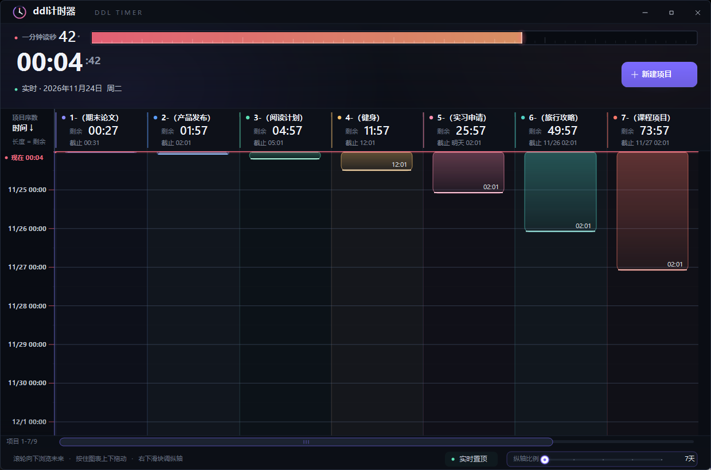
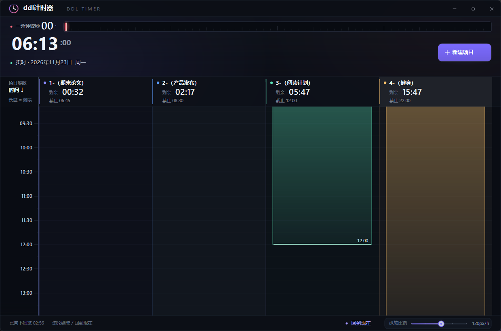
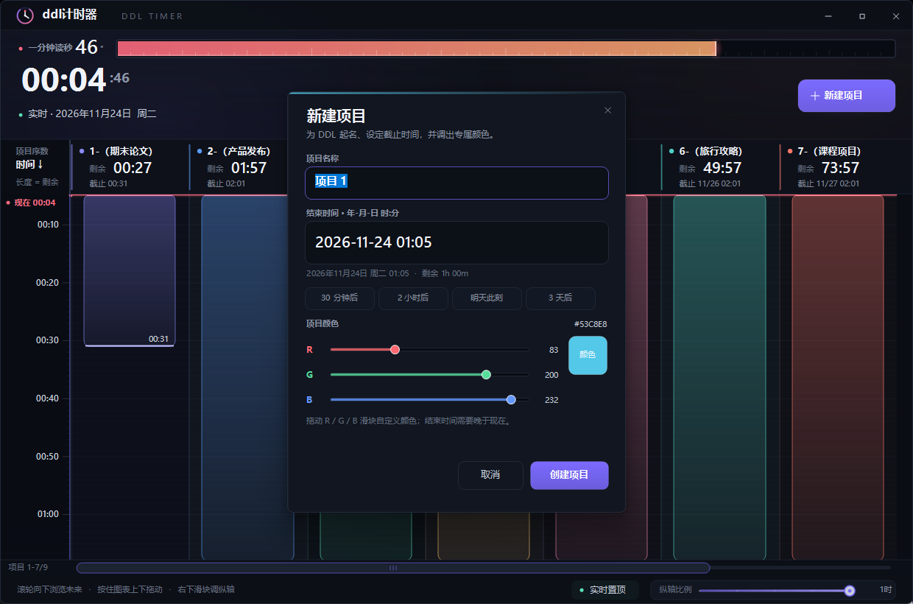
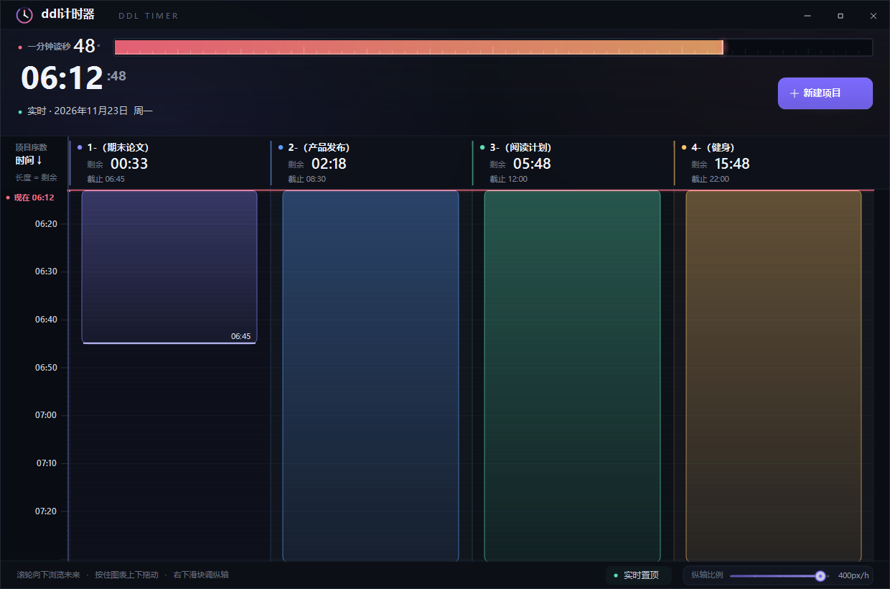
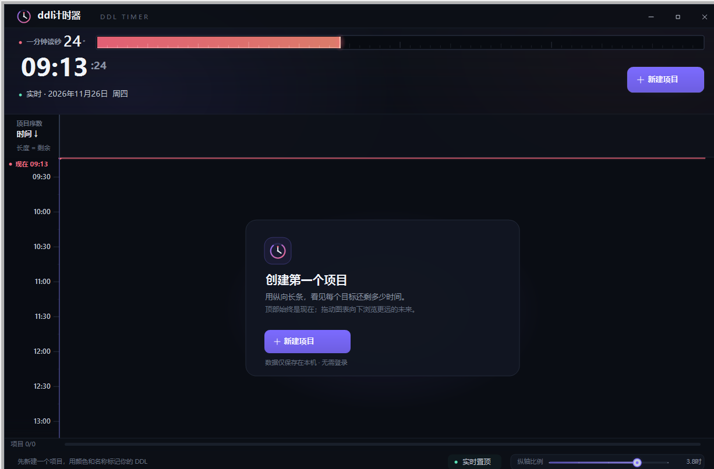

# ddl计时器

[](LICENSE)
[](https://github.com/zhll666/ddl-timer)

> 现在是图表的原点；每个 DDL 还剩多久，用一根矩形一眼看到。

作者：**Zhenghao Chen** ([@zhll666](https://github.com/zhll666))  
GitHub：[zhll666/ddl-timer](https://github.com/zhll666/ddl-timer) · [下载 Releases](https://github.com/zhll666/ddl-timer/releases)



## 核心设计

- **现在固定在顶端**：图的第 0 行永远是当前时间；随着秒针推进，未来刻度从下往上滚动。
- **横轴是项目序号和名字**：列头显示 `1-（期末论文）`、`2-（产品发布）`。
- **表头显示剩余时间**：采用 `HH:mm`，例如「剩余 02:17」；下一行是截止时间。
- **矩形长度 = 剩余时间**：矩形上边贴住「现在」线，下边落在结束时间上。
- **无限向下浏览**：滚轮或按住图表上下拖动，可一直查看更远的未来。
- **项目名称**：新建项目时填写，最多 24 个字符；之后双击表头或右键可改名。
- **RGB 自定义颜色**：三条滑块分别调节 R / G / B 分量（0–255），实时预览颜色和 `#RRGGBB`。
- **一分钟读秒**：顶部 60 秒占空比矩形，只保留左侧秒数，不再显示读秒条后面的文字。
- **纵轴比例滑块**：右下角拖动，压缩或拉伸未来时间密度。
- **本地 TXT 记忆**：项目序数、名称、结束时间、颜色等信息写入本地 `data.txt`；关闭后再次运行自动恢复。
- **到期自动清理**：当前时间超过结束时间时自动删除该项目，后面的项目序号整体前移一位。
- **不做计时**：没有开始/停止、运行卡片、计时记录或今日总计，只做 DDL 截止看板。

## 图表怎么读

```
现在 06:12  ─────────────────────────────
  06:30    [1-（期末论文）] ███████  00:33 → 06:45
  07:30    [2-（产品发布）] ███████████████  02:17 → 08:30
  08:30    [3-（阅读计划）] ███████████████████████ ...
```

| 位置 | 含义 |
| --- | --- |
| 左侧刻度 | 从现在开始的真实时钟时间 |
| 列头 `1-（期末论文）` | 项目序号 + 名称（横轴） |
| 列头 `剩余 02:17` | 剩余时间，用时:分表示 |
| 列头 `截止 08:30` | 矩形下边界对应的时间 |
| 彩色矩形 | 从当前时间到结束时间的剩余长度 |



## 新建 / 编辑项目

点击右上角 **「＋ 新建项目」**，填写：

1. **项目名称**（默认给你一个「项目 N」，可直接改）。
2. **结束时间**：完整的年、月、日、时、分，例如 `2026-12-01 08:30`；结束时间必须晚于现在。
3. **项目颜色**：拖动 R / G / B 三条滑块，右侧色块和 `#RRGGBB` 实时变化。

也可以用「30 分钟后 / 2 小时后 / 明天此刻 / 3 天后」快速设置结束时间。



编辑已有项目：双击项目表头，或右键列 → **编辑项目…**。名称、颜色、结束时间都可以重新设置。

## 操作速查

| 操作 | 方式 |
| --- | --- |
| 新建项目 | 右上角「新建项目」；或 `Ctrl + N` |
| 编辑项目 | 双击表头，或右键 → **编辑项目…** |
| 向下浏览未来 | 鼠标滚轮；或按住图表上下拖动 |
| 回到现在 | 底部 **回到现在**，或 `Home` / `F` |
| 调整纵轴 | 右下角滑块；`Ctrl + 滚轮`；`1` / `2` / `3` 预设 |
| 键盘滚动 | `↑` / `↓` / `PageUp` / `PageDown` |
| 删除项目 | 右键项目列 → **删除项目**（后续项目自动前移） |

## Windows 提示「已保护你的电脑」

当前发布的 exe 没有购买商业代码签名证书，因此 Windows SmartScreen 可能弹出：

> Windows 已保护你的电脑 / Microsoft Defender SmartScreen 阻止了无法识别的应用启动

这不是保存失败——**被拦截时程序根本没有启动，所以不会生成 `data.txt`**。处理方式：

1. 点击提示里的 **「更多信息」**，再点 **「仍要运行」**。
2. 如果文件是从网络下载的，右键 exe → **属性** → 勾选 **解除锁定**；或在 PowerShell 执行：
   ```powershell
   Unblock-File .\ddl计时器.exe
   ```
3. 如果 Windows 11 的 **Smart App Control** 仍然直接拦截、没有「仍要运行」，请从源码构建：
   ```powershell
   powershell -NoProfile -ExecutionPolicy Bypass -File .\build.ps1
   ```
   然后运行新生成的 `ddl计时器.exe`。仓库只提交源码，不提交 exe。
4. 要让所有用户都完全无警告，需要使用受信任的代码签名证书对 exe 签名；MIT 开源仓库本身不附带证书。

程序启动后，新建项目或关闭窗口时就会在 exe 同目录生成 `data.txt`；如果目录不可写，则写入 `%APPDATA%\DDLTimer\data.txt`。README 下方的「本地记忆与自动清理」有完整格式。

## 本地记忆与自动清理

所有项目都保存在一个可直接阅读、编辑的文本文件里。默认就在 `ddl计时器.exe` 旁边：

```text
.\data.txt
```

- 程序目录可写时，`data.txt` 会和 exe 放在一起，打开文件夹就能看到、直接编辑。
- 如果程序放在 `Program Files` 等不可写目录，会自动回退到 `%APPDATA%\DDLTimer\data.txt`。
- 旧版本保存在 `%APPDATA%\DDLTimer\data.txt` 或 JSON 里的数据，会自动迁移到新的 TXT。

格式示例：

```text
# ddl计时器 · 本地记忆文件
version=1
pxHour=120
zoom=1
count=2

[1]
name=期末论文
end=2026-11-23 06:45
color=#8B8BFF
created=2026-11-23 06:12:45

[2]
name=产品发布
end=2026-11-23 08:30
color=#5B9DFF
created=2026-11-23 06:12:45
```

- **自动保存**：新建、编辑、删除、到期清理、调整纵轴比例以及关闭窗口时都会写入 TXT。
- **自动恢复**：再次运行软件时读取 `data.txt`，恢复名称、颜色、结束时间和项目序数。
- **到期删除**：启动时、运行过程中以及关闭前都会检查；当前时间超过某个项目的结束时间，该项目自动移除。
- **序数前移**：删除到期项目后，剩余项目按顺序重新编号为 `1、2、3…`，图表列头同步更新。
- **手动删除**：右键删除项目后同样会把后面的项目整体前移一位。
- **可直接编辑 TXT**：按示例格式修改后保存，重新打开软件即可生效；程序会补齐缺失的名称、颜色和序数。
- `data.txt.bak` 为上一次保存的备份；损坏文件会另存为 `data.txt.corrupt-时间戳`。
- 若本地还没有 TXT，会尝试读取 `%APPDATA%\DDLTimer\data.txt`、旧 JSON 或 `%APPDATA%\ChronoRuler\data.json` 并迁移。
- 迁移数据：退出后连同 `data.txt` 一起复制到另一台电脑的 exe 同目录即可。

## 一分钟读秒

顶部矩形的彩色填充比例 = `当前秒数 / 60`，每一秒对应一根刻度。  
读秒条后面不再显示「X / 60 秒」和剩余秒数，左侧只保留大号秒数和「一分钟读秒」。



首次启动会显示空的未来时间轴：



## 构建

要求：Windows 10 / 11，自带 .NET Framework 4.8，无需 SDK。

```powershell
powershell -NoProfile -ExecutionPolicy Bypass -File .\build.ps1
```

脚本调用系统自带的 `csc.exe`，把 `src\*.cs` 编译为单文件 **`ddl计时器.exe`**。

## 目录

```
ddl计时器/
├─ LICENSE                MIT
├─ README.md
├─ .gitignore
├─ build.ps1
├─ app.manifest
├─ assets/
│  ├─ icon.ico
│  └─ icon.png
├─ src/
│  ├─ Program.cs
│  ├─ MainForm.cs         未来时间轴、无限滚动、滑块
│  ├─ MainForm.Paint.cs   读秒、倒计时矩形、时间轴绘制
│  ├─ Dialogs.cs          名称 / RGB 颜色 / 结束时间 / 确认对话框
│  ├─ Theme.cs
│  ├─ Model.cs
│  ├─ Store.cs
│  └─ AssemblyInfo.cs
└─ screenshots/
```

构建产物 `ddl计时器.exe` 和本地运行数据 `data.txt` 由 `.gitignore` 排除，不提交到仓库；可执行文件通过 GitHub Releases 分发。

## 已知边界

- 结束时间必须晚于当前时间；当前时间超过结束时间后，项目会自动删除，后续项目序号前移。
- 当前版本没有计时/开始/停止功能，也不展示历史记录。
- 结束时间以分钟为输入精度；TXT 中支持到秒，但保存时统一写成分钟。
- 项目名称最多 24 个字符；颜色使用 RGB 三通道，不支持透明色。
- 可向下浏览约 100 年的未来，实际使用中视为无限。

## 作者与许可

作者：**Zhenghao Chen** ([@zhll666](https://github.com/zhll666))  
项目地址：[https://github.com/zhll666/ddl-timer](https://github.com/zhll666/ddl-timer)

本项目采用 **MIT License**，允许自由使用、修改、分发和商业使用，但需保留版权与许可声明。  
完整文本见 [LICENSE](LICENSE)。

Copyright © 2026 Zhenghao Chen
